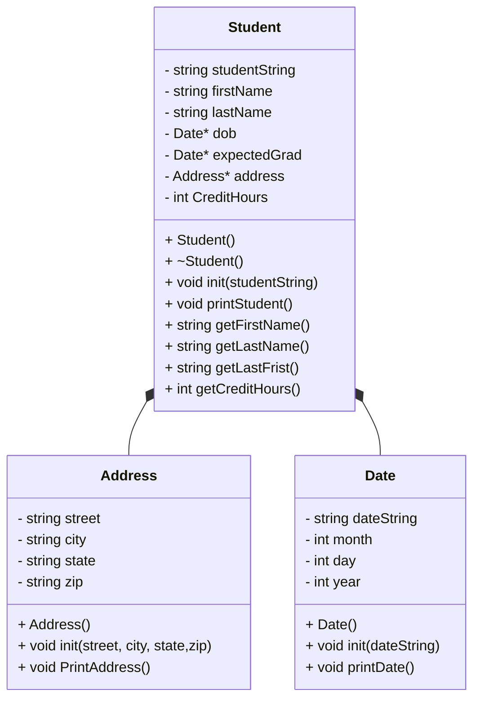

# CS121-Heap-of-Students-Part-1-Project
## UML Class Diagram 

## Address Class
```
Address()
    - init(string, street, string city, string, state, string zip) 
        -  street = s
        - city = c 
        - state = state
        - zip = zip 
    - printAddress() 
        - print street 
        - print city, state and zip 
```

## Date Class
``` 
date() 
    - month = 0 
    - day = 0 
    - year = 0 
    
    - init(d) 
        - dateString = d
        - stringstream (d)
        - read month 
        - read / 
        - read day 
        - read / 
        - read year 
    
    - printDate() 
        - if ( month == 1) 
            - print month name 
        - print day and year (srd::cout << day << year) 
```

## Student Class
``` 

Student() 
    - create date object for birth date
        - dob = new Date()
    - create data object for graduation date 
        - expectedGrad = new address() 
    - create address object 
        - address = new address() 
    - credit hour = 0 

    ~Student()
        - delete birth date  
             - delete dob
        - delete graduation date
            - delete expectedGrad
        - delete the address
            - delete address
    - init(s) 
        - student string = s
        - create stringstream 
            - std::string street
            - std:: string city
            - std::string state
            - std::string zip 
            - std:: dobString
            - std::string gradString

        - get first name 
            - getline(ss, firstname) 
            - getline(ss, lastname)
            - getline(ss, street) 
            - getline(ss, city) 
            - getline(ss,state)
            - getline(ss,  zip) 
            - getline(ss dob) 
            - getline(ss, grad) 
            - getline(credit hour) 

        - adress information to addrress
            - address-> init( street, city, state and zip ) 
        - birth date to date 
            - dob-> init (dobstring) 
        - graduation date to date 
            - expectedGrad-> init(grad) 

        - printStudent()
            - print student name
            - print address 
            - print birth date 
            - print graduation date 
            - print credit hours 
        
        - getFirstname() 
            - return firstname 
        - getLastname() 
            - return lastname
        - getlastfirst() 
            - return last name and then first name 
        - getcredithours() 
            - return credit hours 
```

## Main 
```
main() 
int main() 
    - create vector of student pointers
    - loadStudents(students) 
    - choice = "" 
    - while (choice != "0")
        - choice = menu() 
        - if choice == "1" 
            - showStudentNames(students)
        - else if (choice == "2") 
            - printStudents(students)
        - else if (choice == "3")
            - FindStudent(students)
        - else if (choice == "0") 
            - print thank you 
        - else
            - print Invalid choice 
    - delStudents(students) 
    - return 0 
```
## loadStudents
```
loadStudents(students) 
    - open students.csv file 
    - if file is not open 
        - print error 
        - return 
    - create string line 
    - while read each line from students.csv file 
        - if line is not empty 
            - create new student on heap 
            - studnet using line inilialize
            - insert student pointer in vector 
    - close file
```
## printStudents
```
printStudents(students) 
    - for each student in vector 
        - student pointer 
        - printStudent() 
        - print seperate line 
```
## showStudentNames
```
showStudentNames(students) 
    - for each Student in vector 
        - getLastFirst() 
        - print last name and first name 
```
## findStudent
```
findStudent(students)
    - create string lastName
    - ask user for last name 
    - read lastName 
    - found = false 
    - for each char in LastName
        - chnage char to lowercase
    - for each student in vector 
        - get student pointer 
        - getLastname() 
        - for each char in name 
            - char to lowercase change 
        - if name Lastname if its contain
            - printStudent() 
            - print separate line 
            - found = true 
    - if found == false 
        - print student not found 
```
## delStudents
```
delStudents(students) 
    - for each Student in vector 
        - delete student from heap
    - clear students vector 
```
## menu
```
menu() 
    - create string choice 
    - print 0 to quit 
    - print 1 to show student names 
    - print 2 to show all student data
    - print 3 to find a student 
    - ask user to choose 0-3 
    - read choice 
    - return choice 

        
